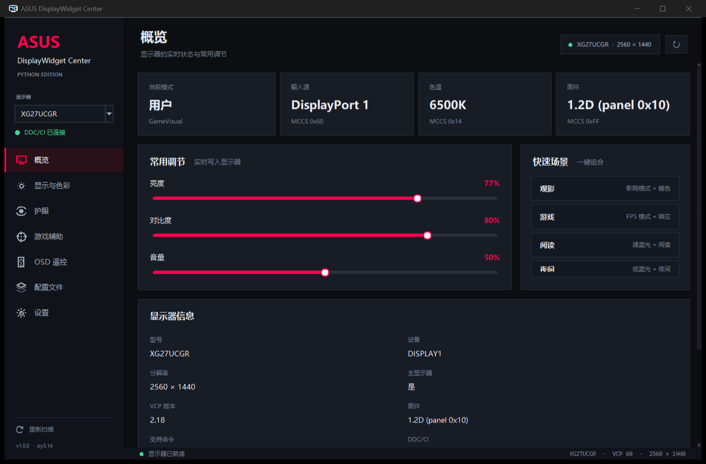
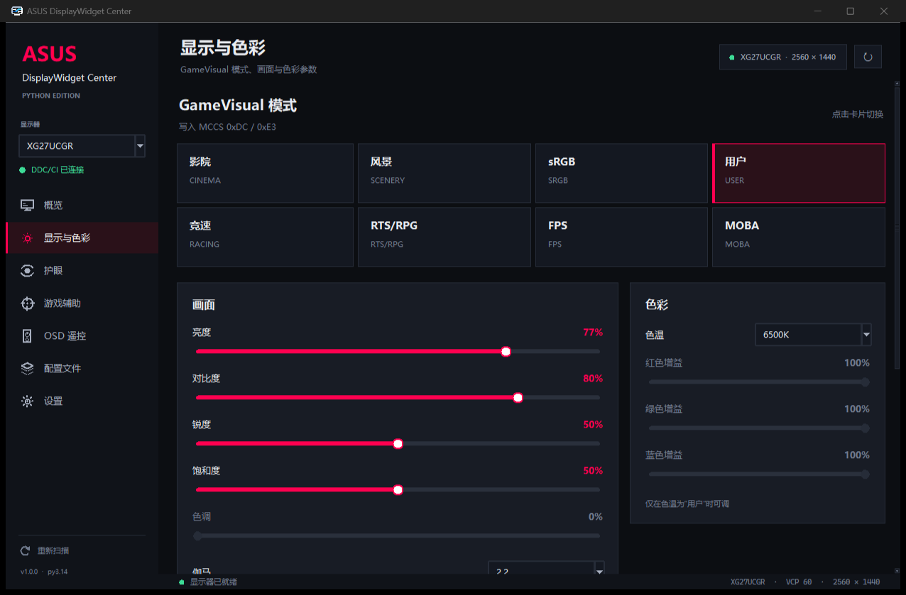
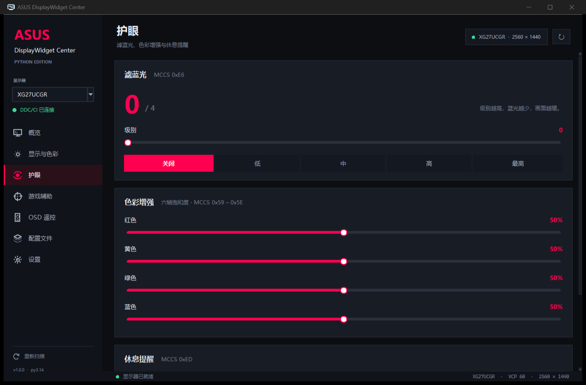
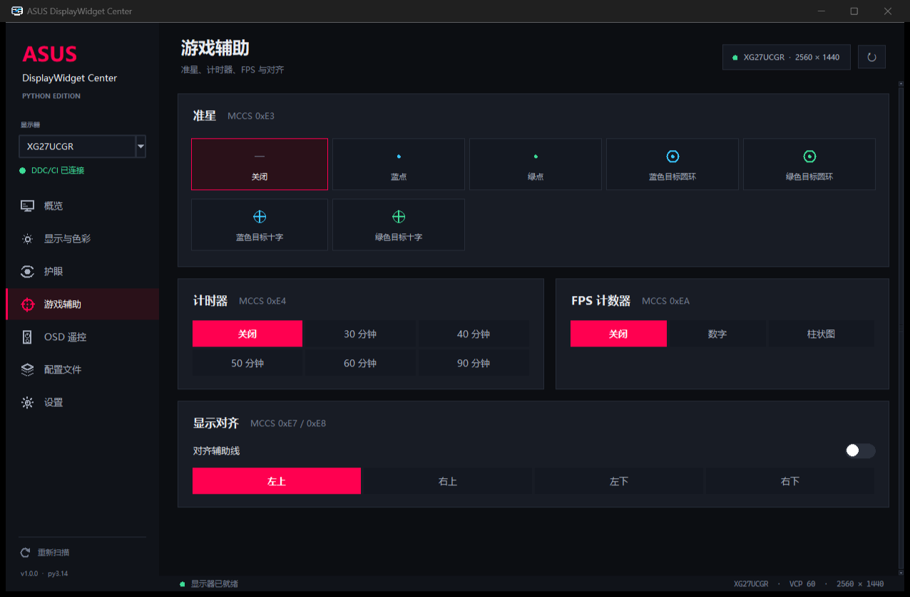
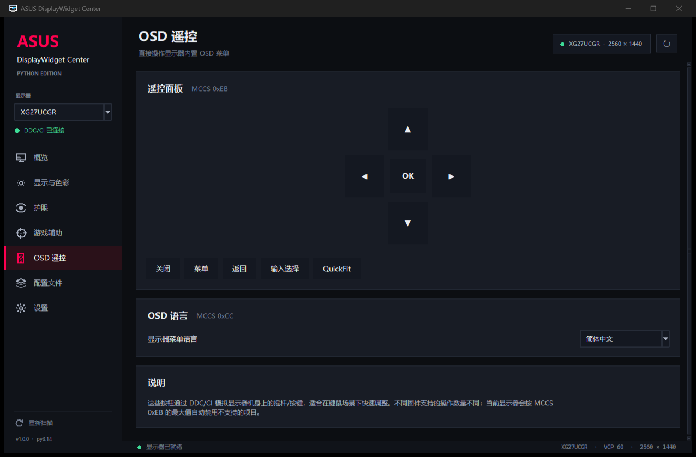
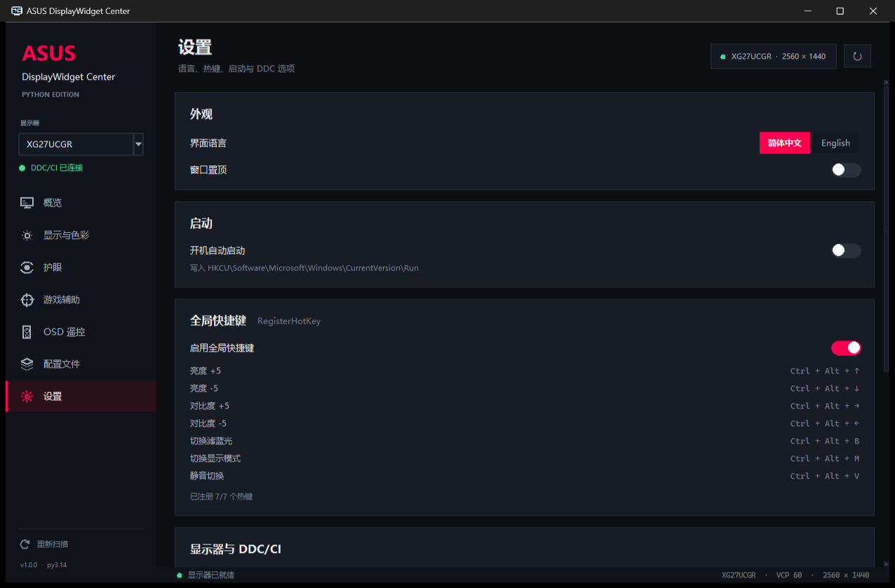
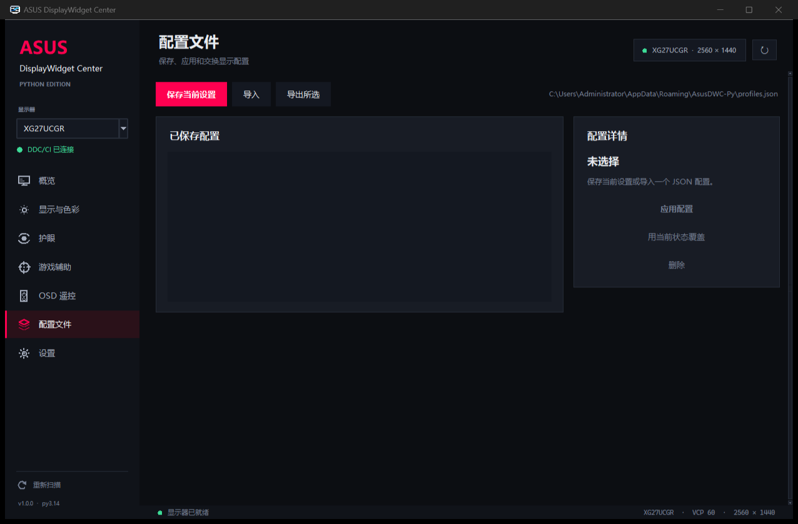
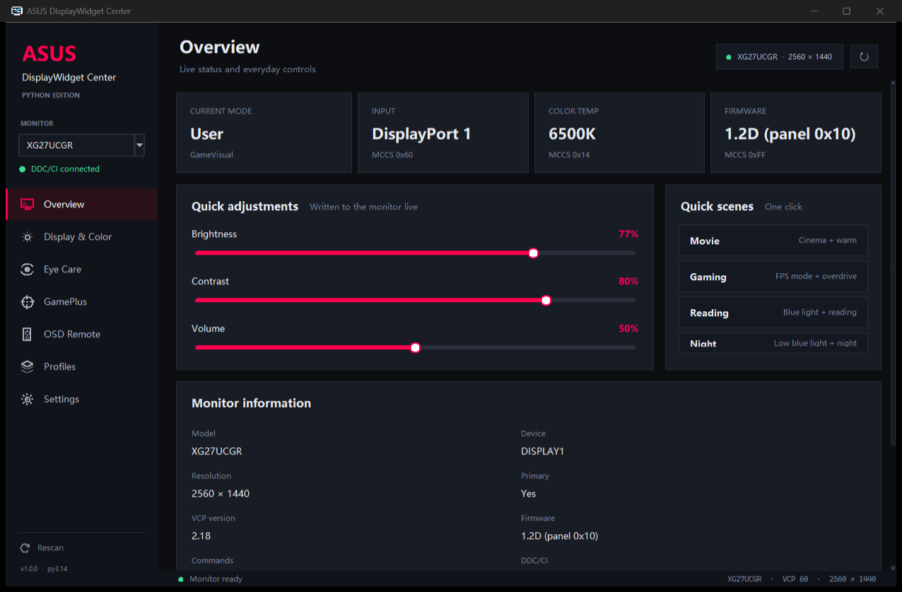

# ASUS DisplayWidget Center · Python / tkinter 复刻版

用 **纯 Python + tkinter + ctypes** 重新实现 ASUS DisplayWidgetCenter 的显示器控制核心。
不依赖任何第三方 Python 库，直接调用 Windows 的 `dxva2.dll` / `gdi32.dll` 完成
DDC/CI（MCCS）读写，界面尽量还原原版 ROG 深色风格。

> 原程序：`C:\Program Files (x86)\ASUS\DisplayWidgetCenter`，
> `DisplayWidgetCenter.exe` **1.5.1.3**（.NET Framework 4.7.2 / WPF）。
> 完整的逆向过程、证据与 VCP 对照表见
> [REVERSE_ENGINEERING.md](REVERSE_ENGINEERING.md)。



## 功能

| 页面 | 功能 |
| --- | --- |
| **概览** | 当前模式 / 输入源 / 色温 / 固件、亮度 / 对比度 / 音量、快速场景、输入源切换、显示器信息 |
| **显示与色彩** | GameVisual 模式卡片（Gaming / MainStream / ProArt 三套）、亮度、对比度、锐度、饱和度、色调、伽马、色温、RGB 增益、OverDrive、Shadow Boost、ASCR、省电、输入源、音量、静音 |
| **护眼** | 滤蓝光等级（0–4）、六轴色彩增强（红/黄/绿/蓝）、休息提醒 |
| **游戏辅助** | 准星（自动识别新旧两种准星类型）、计时器、FPS 计数器、显示对齐、位置 |
| **OSD 遥控** | 通过 MCCS 0xEB 模拟显示器摇杆：上/下/左/右/确认/返回/菜单/关闭/输入选择/QuickFit |
| **配置文件** | 保存 / 应用 / 覆盖 / 删除 / 导入 / 导出 JSON 配置 |
| **设置** | 中英文切换、窗口置顶、开机自启、全局快捷键、重新扫描、刷新参数、VCP 命令表、恢复出厂、关于 |

其他：多显示器枚举与切换、能力字符串磁盘缓存（冷启动从约 5 秒降到约 1.4 秒）、
支持缺失自动禁用、异步 DDC 队列（不会卡住 UI）、日志式状态栏。



## 快速开始

要求：Windows 10/11，Python **3.10+**（仅标准库），显示器支持 DDC/CI。

```bat
cd /d C:\Users\Administrator\Documents\AsusDisplayWidgetCenter-Py
python main.py
```

或双击 `run.bat`（优先使用 `pythonw`，不弹控制台）。

指定启动页 / 语言：

```bat
python main.py --page display --lang en
```

页面 ID：`overview` `display` `eyecare` `gameplus` `osd` `profiles` `settings`。

### 命令行诊断

```bat
python cli.py probe       :: 枚举显示器、能力字符串、关键 VCP 当前值
python cli.py dump        :: 打印显示器声明的全部 VCP
python cli.py test-write  :: 逐项写入并恢复（亮度/对比度/音量/滤蓝光/OD/伽马/模式/色温）
```

`test-write` 会短暂改变画面，但结束前会恢复原值；模式切换时会短暂黑屏，属正常。

## 目录结构

```
main.py                  入口（--page/--lang）
cli.py                   无 GUI 诊断工具
asusdwc/
  ddc.py                 ctypes：EnumDisplayMonitors → GetPhysicalMonitors →
                         GetVCPFeatureAndVCPFeatureReply / SetVCPFeature / capabilities
  vcp.py                 VCP 常量、能力字符串解析、机型识别、模式/色温/伽马表
  controller.py          显示器状态、探测、两阶段读取、配置捕获/应用
  app.py                 tkinter 主窗口与 7 个页面
  widgets.py             自绘滑杆/开关/分段控件/模式卡/滚动容器/图标
  theme.py               深色主题、字体、Mica/暗色标题栏
  hotkeys.py             RegisterHotKey + 消息循环线程
  store.py               设置/配置/能力缓存/开机自启
tests/
  test_core.py           纯逻辑单元测试（10 项）
  test_ui_smoke.py       真机端到端冒烟测试
docs/                    截图
```

## 实现要点

* **DDC/CI 访问链路**与原版一致：
  `EnumDisplayMonitors` → `GetNumberOfPhysicalMonitorsFromHMONITOR` →
  `GetPhysicalMonitorsFromHMONITOR` → `GetVCPFeatureAndVCPFeatureReply` /
  `SetVCPFeature`；能力字符串用 `GetCapabilitiesStringLength` +
  `CapabilitiesRequestAndCapabilitiesReply`。
* 所有 DDC 事务经过全局锁，并在两次调用间保留 ≥32 ms 间隔（原版 `VCPAPI._lock` +
  `Set_Time = 20 ms`），避免 ASUS 面板丢包。
* **两阶段探测**：先读 14 个常用 VCP 让 UI 尽快出现，再在后台补齐其余参数。
* **能力字符串缓存**：按 `设备名|描述` 保存到
  `%APPDATA%\AsusDWC-Py\capabilities.json`，7 天过期；原版也把能力字符串缓存在
  `ProgramData\ASUS\DisplayWidgetCenter\UserConfig\CapabilityData.json`。
* **机型识别**完全移植 `Utils.GetProductLine`：`XG/PG/VG`→Gaming，`PA/PQ`→ProArt，
  `VX/VP/...`→MainStream，`MB/MQ`→Portable；不同系列使用不同的 GameVisual 模式表和色温表。
* **伽马**使用 ASUS 的 16 位值（`0x5000`=1.8、`0x6400`=2.0、`0x7800`=2.2、
  `0x8C00`=2.4、`0xA000`=2.6），与原版 `SetGamma` 一致。
* **开关位域**：ASCR = VCP `0xFD` bit 1，静音 = VCP `0xFC` bit 3。
* **准星类型**：能力字符串 `E3` 含 `07` 或 `0C` 时只显示新式 7–12 号样式，
  否则显示旧式 1–6 号样式（移植 `CheckCrosshairTypeFromDictionary`）。
* 全局快捷键：`Ctrl+Alt+↑/↓` 亮度、`Ctrl+Alt+←/→` 对比度、`Ctrl+Alt+B` 滤蓝光、
  `Ctrl+Alt+M` 循环显示模式、`Ctrl+Alt+V` 静音。
* 单实例运行（与原版一致的命名互斥量），避免两个进程同时抢占 DDC/热键。
* 进程保持 DPI-unaware、由 Windows 统一缩放；在 4K/200% 下布局不会错位（略糊）。

## 兼容性与限制

* 控制是否可用取决于显示器的 MCCS 能力字符串；不可用时控件自动禁用。
  部分厂商选项在 HDR / sRGB 模式下会被固件锁定，属正常。
* 虚拟显示器、采集卡、KVM 虚拟屏通常不响应 DDC/CI，会以“不支持 DDC”列出。
* 未复刻的在线/外设功能：AI Game Visual、App Sync、Aura Light Bar、
  ProArt 校准报告、固件升级、PIP/PBP/KVM、OLED 专项、ICC 安装、账号与云服务。
  这些依赖原版服务端、HID 设备或私有 DLL，且与“用 Python 控制显示器”无关。
* 恢复出厂（0x04/0x08）会覆盖显示器内部设置，请谨慎。
* 本项目的 VCP 映射来自对本机安装文件的反编译与真机读写验证，仅用于互操作与学习；
  ASUS / ROG 是其各自权利人的商标。

## 测试

```bat
python -m unittest discover -s tests -p "test_core.py" -v
python tests\test_ui_smoke.py
```

真机测试环境：ASUS **XG27UCGR**（60 个 VCP，VCP 2.18，固件 1.2D，面板 0x10），
Windows 11 26100。测试结果见逆向报告第 9 节。

## 截图

| 护眼 | 游戏辅助 |
| --- | --- |
|  |  |

| OSD 遥控 | 设置 |
| --- | --- |
|  |  |

| 配置文件 | English UI |
| --- | --- |
|  |  |
