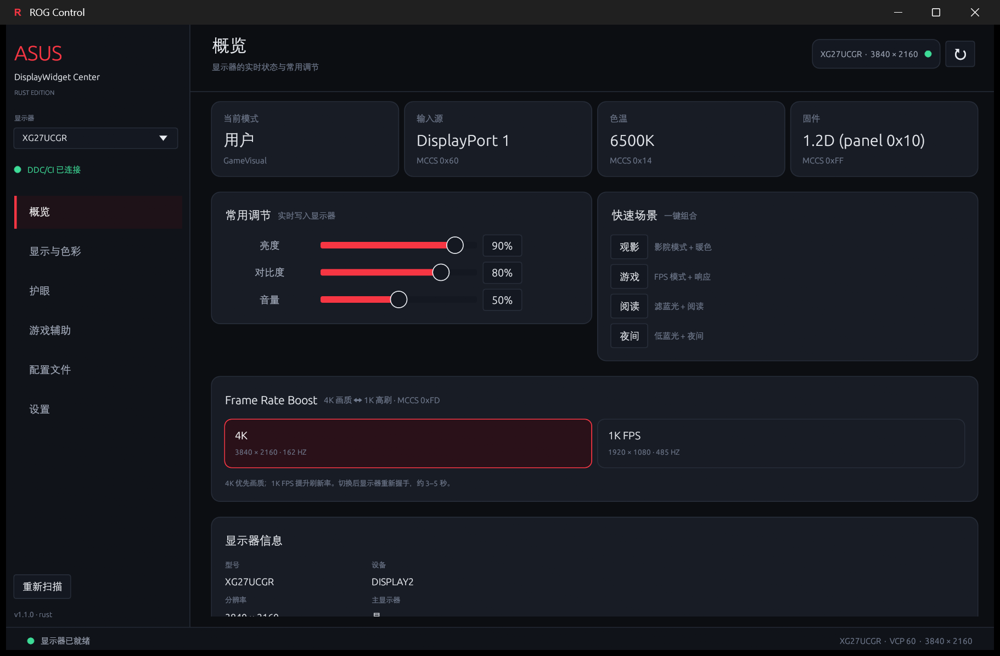
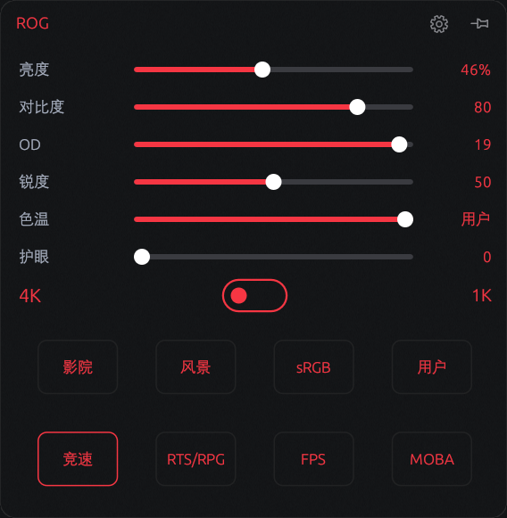
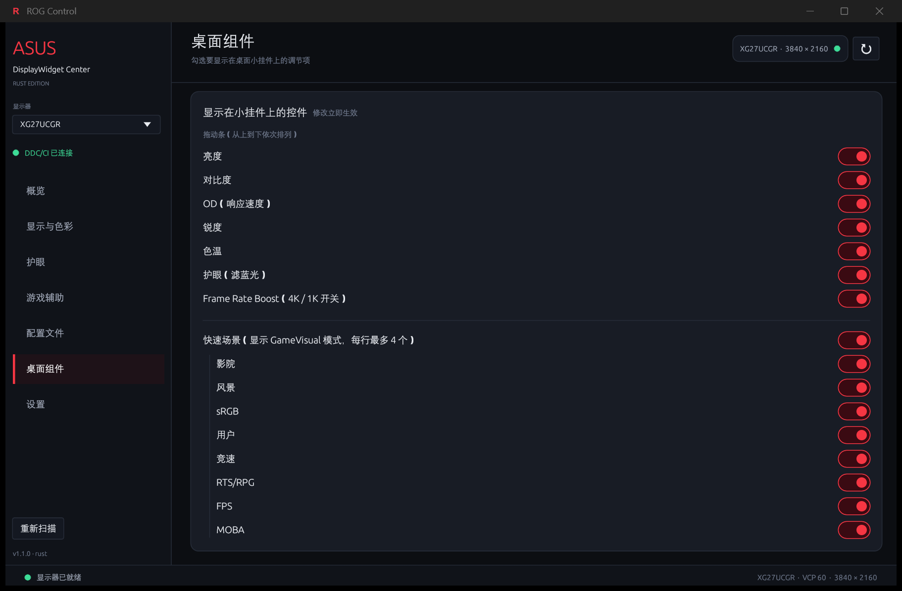
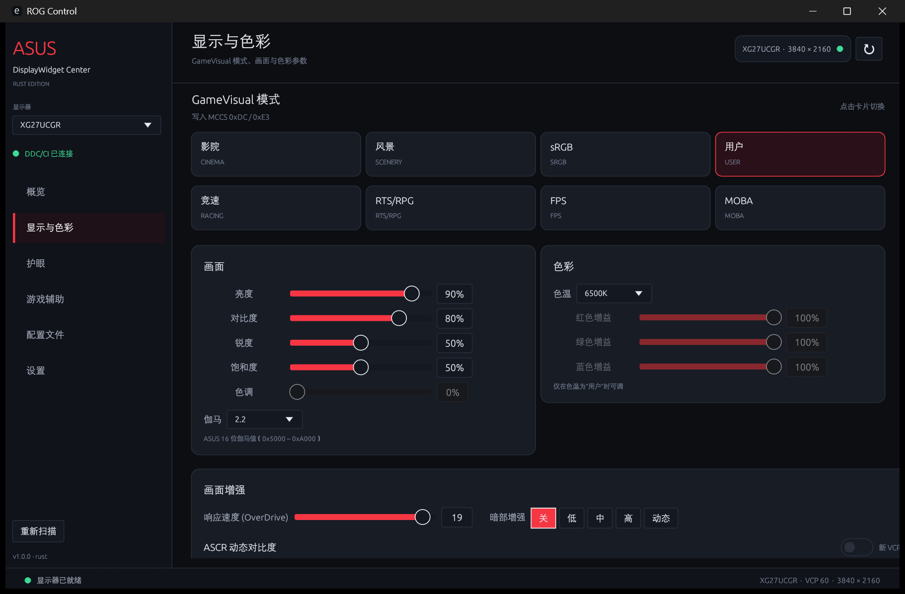
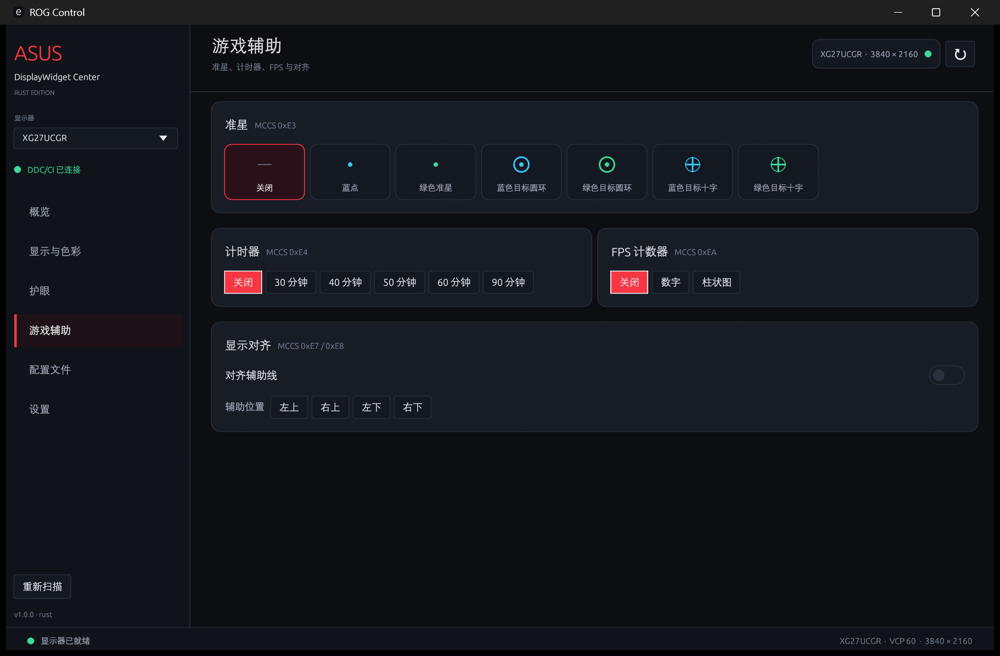
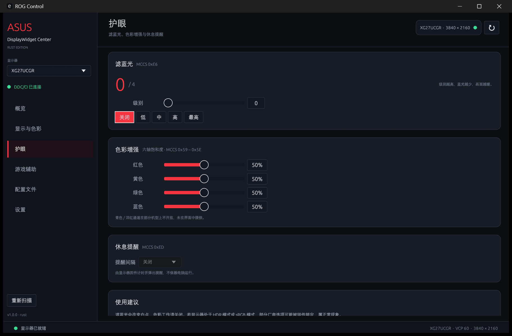
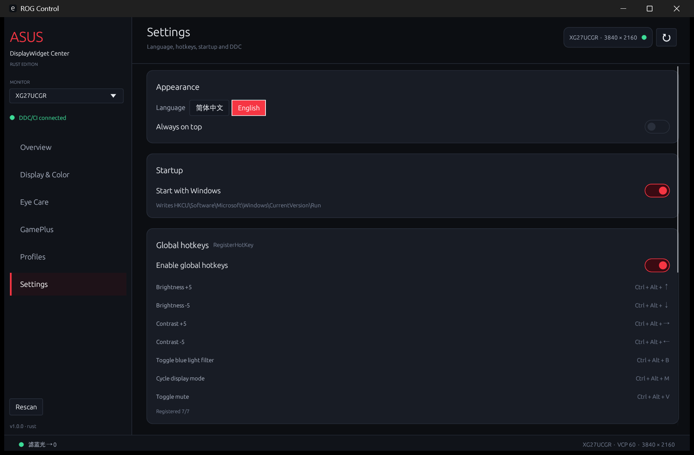
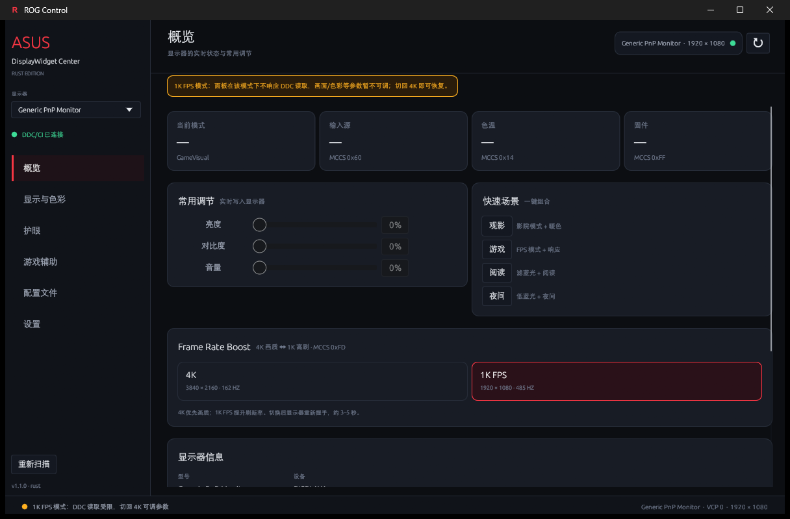

# RogControl (Rust) — ASUS DisplayWidget Center 复刻

Rust + egui 重写的显示器控制程序：常驻托盘的小挂件 + 完整控制主界面。
功能移植自同仓库的 Python/tkinter 复刻版
[`../AsusDisplayWidgetCenter-Py`](../AsusDisplayWidgetCenter-Py)，
后者基于对 ASUS **DisplayWidgetCenter 1.5.1.3**（.NET/WPF）的逆向分析。



## 启动与窗口行为

| 行为 | 说明 |
| --- | --- |
| 默认启动 | **只显示小挂件**；主界面不创建、不占用任务栏 |
| 打开主界面 | 托盘图标**左键单击**，或右键菜单「显示主界面」，或小挂件右上角齿轮 |
| 关闭主界面 | 点窗口 X 只是**隐藏**（销毁该视口），进程与小挂件继续运行 |
| 任务栏图标 | 只在**主界面打开时**出现（`WS_EX_APPWINDOW`）；小挂件始终是工具窗口，不占任务栏 |
| 再次启动 exe | 通过命名事件唤醒已运行实例并打开主界面（单实例） |
| 退出 | 托盘右键 →「退出」 |
| 桌面组件 | 在「桌面组件」页勾选要显示在小挂件上的调节项，修改立即生效 |

小挂件：默认显示亮度滑杆与 4K/FPS 开关；可在「桌面组件」页加入对比度、OD、锐度、色温、护眼和快速场景。
高度随勾选项自动调整，场景固定为底部一排 4 个正方形。



## 桌面组件（可配置小挂件）

主界面新增 **桌面组件** 页，勾选后立即应用到桌面小挂件：

* 拖动条（从上到下依次排列）：**亮度 → 对比度 → OD（响应速度）→ 锐度 → 色温 → 护眼（滤蓝光）**
* **Frame Rate Boost**（4K ↔ FPS）可单独勾选，位于拖动条之后
* **快速场景** 固定在最底部：列出**全部 GameVisual 模式**（影院 / 风景 / sRGB / 用户 / 竞速 / RTS/RPG / FPS / MOBA），**按勾选顺序排列，先勾选的在前**，每行最多 4 个；每个方格四周留 **15px 外边距**，透明底、红字，边框 1px，**当前模式红框、其余 `#212223`**；可在设置页自定义显示哪些模式
* 挂件高度按内容自动伸缩，手动缩放后保存；「全部显示」「恢复默认」可一键切换
* 勾选/取消后**立即写入 `ui.json`**，即使直接结束进程或重启也会保留上次配置；配置行带类似 CSS `:hover` 的高亮与手型光标
* 色温使用离散拖动条，右侧显示当前值（如 `6500K`）；响应速度在小挂件里显示为 **OD**



## 主界面（7 页）

| 页面 | 功能 |
| --- | --- |
| **概览** | 当前模式 / 输入源 / 色温 / 固件；亮度、对比度、音量；4 个快速场景；**Frame Rate Boost**；显示器信息；输入源切换 |
| **显示与色彩** | GameVisual 模式卡片（Gaming / MainStream / ProArt 三套）；亮度、对比度、锐度、饱和度、色调、伽马；色温、RGB 增益（仅「用户」色温可调）；OverDrive、Shadow Boost、ASCR、省电；输入源、音量、静音 |
| **护眼** | 滤蓝光 0–4 档 + 5 个预设；六轴色彩增强（红/黄/绿/蓝）；休息提醒 0–60 分钟 |
| **游戏辅助** | 准星（自动识别新旧两种样式，带预览）；计时器；FPS 计数器；显示对齐与位置 |
| **配置文件** | 保存 / 应用 / 覆盖 / 删除 / 导入 / 导出 JSON；详情面板 |
| **桌面组件** | 勾选小挂件上的拖动条、OD、色温、护眼、Frame Rate Boost，以及要显示的 GameVisual 模式；全部显示 / 恢复默认 |
| **设置** | 中/英切换、窗口置顶、开机自启、全局快捷键、重新扫描、刷新参数、VCP 命令表、恢复出厂、关于 |

| 显示与色彩 | 游戏辅助 |
| --- | --- |
|  |  |

| 护眼 | 设置 |
| --- | --- |
|  |  |

## Frame Rate Boost（4K / 1K 双模）

概览页提供 **Frame Rate Boost** 卡片，通过 VCP `0xFD` 在两种面板模式间切换：

| 模式 | 分辨率 / 刷新率 | 说明 |
| --- | --- | --- |
| **4K** | 3840 × 2160 · 162 Hz | 画面优先 |
| **1K FPS** | 1920 × 1080 · 485 Hz | 高刷新率优先 |

* 切换后显示器会重新握手，黑屏约 3–5 秒；切换期间控件显示进度并禁用。
* 小挂件上的 `4K ↔ FPS` 开关与主界面共享同一状态。
* **1K FPS 模式下这块面板不响应 DDC 读取**（读取会阻塞）。程序在该模式下只做轻量枚举，
  显示黄色提示并禁用画面/色彩等控件；点 **4K** 切回后自动重新扫描并恢复全部参数。
* 进程使用**系统级 DPI 感知**（不是 per-monitor），避免 4K（150%）与 1K（100%）
  切换时 DPI 变化导致 egui 纹理重建崩溃；非系统 DPI 的屏幕上会由 Windows 位图缩放（略糊）。

| Frame Rate Boost（4K） | 切到 1K FPS 后 |
| --- | --- |
|  |  |

## 移植的底层规则

* **DDC/CI 链路**与原版一致：`EnumDisplayMonitors` → `GetNumberOfPhysicalMonitorsFromHMONITOR`
  → `GetPhysicalMonitorsFromHMONITOR` → `GetVCPFeatureAndVCPFeatureReply` / `SetVCPFeature` /
  `GetCapabilitiesStringLength` / `CapabilitiesRequestAndCapabilitiesReply`。
* 所有 DDC 事务经过**全局锁**，相邻事务间隔 ≥ 32 ms（原版 20 ms）。
* **两阶段探测**：先读 14 个常用 VCP 让界面尽快出现，再后台补齐其余参数。
* **能力字符串缓存**：按 `设备名|描述` 存 7 天；「重新扫描」强制重读。
* **机型识别**完整移植 `Utils.GetProductLine`：XG/PG/VG→Gaming，PA/PQ→ProArt，
  VX/VP/…→MainStream，MB/MQ→Portable。
* 四套 GameVisual 模式表、三套色温表、ASUS 16 位伽马值（`0x5000`–`0xA000`）、
  ProArt `(v<<8)|0xFF` 模式打包、准星新旧样式、ASCR/静音的位域读改写。
* 配置捕获/应用沿用 Python 版的 VCP 白名单，JSON 格式与 Python 版互通
  （`vcp` 键为十进制码字符串）。

## 全局快捷键

| 快捷键 | 动作 |
| --- | --- |
| `Ctrl + Alt + ↑ / ↓` | 亮度 ±5 |
| `Ctrl + Alt + → / ←` | 对比度 ±5 |
| `Ctrl + Alt + B` | 切换滤蓝光 |
| `Ctrl + Alt + M` | 循环显示模式 |
| `Ctrl + Alt + V` | 静音切换 |

在「设置 → 全局快捷键」可以整体启用/停用，并查看已注册数量。

## 数据目录

默认 `%APPDATA%\RogControl`：

| 文件 | 内容 |
| --- | --- |
| `settings.json` | 小挂件位置/尺寸/透明/模糊/固定 |
| `ui.json` | 界面语言、置顶、热键开关、选中显示器、最后页面、主窗口几何、**桌面组件勾选项** |
| `profiles.json` | 配置文件列表 |
| `capabilities.json` | MCCS 能力字符串缓存（7 天） |
| `lifecycle.log` | 启动/退出/显示模式切换等诊断记录（排查 Frame Rate Boost 用） |
| `panic.log` | panic 消息与回溯（正常不存在） |

设置环境变量 `ROG_DATA_DIR=<目录>` 可切换到便携模式，所有数据写到指定目录。

## 构建与运行

要求：Windows 10/11 x64、Rust 1.80+、支持 DDC/CI 的显示器。

```bat
cd rust
cargo build --release
target\release\rogcontrol.exe
```

开发构建：`cargo build` → `target\debug\rogcontrol.exe`。

单元测试（能力字符串解析、机型识别、ProArt 模式打包、伽马、准星样式）：

```bat
cargo test
```

> 若在受限沙箱里 `cargo test` 因禁止管道捕获而报「拒绝访问」，可直接运行
> `target\debug\deps\rogcontrol-*.exe --test-threads=1` 并把输出重定向到文件。

## 与 Python 版的差异

* **OSD 遥控页未移植**（按移植需求排除）；底层 `0xEB` 常量仍保留。
* 保留并整合了原 Rust 版的 **Frame Rate Boost**（4K/1K，VCP `0xFD`），
  切换后按模式自动重扫；1K 下跳过 VCP 读取以保证界面不卡死。
* 新增 **桌面组件** 页：小挂件可配置为最多 6 条拖动条 + Frame Rate Boost + 全部 GameVisual 模式方格（每行 4 个），
  高度自动适配并持久化到 `ui.json` 的 `widget` 字段。
* 从小挂件启动，主界面按需打开；Python 版是单一整窗应用。
* 未做（与 Python 版一致或原版依赖私有服务）：AI Game Visual、App Sync、
  Aura Light Bar / R1 眼镜、固件升级、ProArt 校准报告、PIP/PBP/KVM、OLED 专项、
  账号与云服务、ICC 安装。
* 青色/洋红饱和度仍只在后台读取，未在界面提供（与 Python 版一致）。

## 兼容性与限制

* 控件是否可用取决于显示器的 MCCS 能力字符串；不支持时对应控件自动禁用。
* 开机自启时若显示器/DDC 尚未就绪，程序会在启动后自动重扫并唤醒挂件，无需先打开主界面。
* 部分厂商选项在 HDR / sRGB 模式下会被固件锁定，写入可能成功但值不变。
* 虚拟显示器、采集卡、KVM 虚拟屏通常不响应 DDC/CI，会以「无 DDC」列出。
* 恢复出厂（`0x04` / `0x08`）会覆盖显示器内部设置，请谨慎使用。
* 本项目的 VCP 映射来自对原版安装文件的反编译与真机读写验证，仅用于互操作与学习；
  ASUS / ROG 是其各自权利人的商标。
